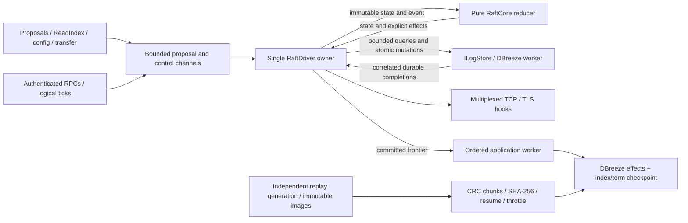

# Raft for .NET 8

Embedded crash-tolerant consensus for logical commands applied to DBreeze. All supported projects target **net8.0**. DBreeze is pinned to **1.142.2026.1016-beta**, using its .NET 8 asset; the beta suffix is upstream's version name. Dependencies are centrally managed and locked. The assembly/package is `Raft.Net8`, namespace `Raft`.

Implemented: pre-vote, check-quorum, ReadIndex, leadership transfer, learners, journaled hot Add/Remove with replicated routes and durable operation IDs, corrected single-server membership changes, batched durable writes, bounded replication pipelines, CRC-checked recovery, and chunked resumable snapshots. See the [interactive solution](HumanTest/Raft.HumanTest.sln), [operational runbook](docs/OPERATIONS.md), [configuration reference](docs/CONFIGURATION.md), [architecture/storage notes](docs/ARCHITECTURE.md), and [LLM usage skill](../_docs/raft_skill.md).

Accepted performance baseline: commit `d44147effdb20271854dd758cc6f9073543a554d`, including Hot Add/Remove, accepted by the user on2026-11-14. Future comparisons use fresh paired runs against this version. See the [baseline identity and evidence](benchmarks/baselines/hot-membership-2026-11-14.json).

Human tutorials: [English HTML book](docs/human/tutorial/book-en.html) · [Русская HTML-книга](docs/human/tutorial/book-ru.html) · [language index](docs/human/tutorial/index.html). Both editions include the runnable C# companion, three-process startup, configuration, disk/RAM storage, snapshots, recovery and detailed limits.

## Build and run

Install a .NET 8 SDK and run from `RaftNet8/`:

```sh
dotnet restore Raft.Net8.sln --locked-mode
dotnet build Raft.Net8.sln -c Release --no-restore
dotnet test tests/Raft.Tests -c Release --no-build --no-restore
dotnet run --project HumanTest/Raft.Demo -c Release --no-build -- --scenario
dotnet run --project HumanTest/Raft.Demo -c Release --no-build
```

`scripts/verify.ps1` runs build/tests/demo. Open `HumanTest/Raft.HumanTest.sln` in Visual Studio and select `Raft.Demo` to watch elections, partitions, application, snapshot catch-up and changes to voters/learners. The console's `help` lists commands. Each demo node owns separate log/application/snapshot directories and a loopback endpoint. See [human-test instructions](HumanTest/README.md).

## Architecture and safety



- **Persistence before acknowledgment:** term/vote and log mutations complete durably before dependent votes/AppendEntries acknowledgments leave the driver. V2 batches use one DBreeze transaction/commit. An uncertain storage/application failure fail-stops the node and preserves the original exception through `Completion`.
- **Elections:** voters check log freshness; pre-vote does not modify the receiver's term/vote or reset its timer. Recent leader contact suppresses disruptive pre-votes. Leaders check quorum. Learners and removed nodes never campaign or grant votes.
- **Commitment:** only a current-term entry advances a leader's quorum commit. Election no-ops establish that term. Stale/canceled/reordered replies cannot regress a newer replication flight or manufacture a match.
- **Reads:** `ReadIndexAsync` requires a committed entry in the current term, confirms a fresh context with a voter quorum, captures the committed index, then waits for local application. Concurrent reads share a confirmation round. `ReadBarrierAsync` remains available and appends a no-op. Plain application/status reads can be stale.
- **Membership:** the latest log configuration is active on append and restored on rollback. Change one server/role at a time, after the prior configuration **and a current-term entry** commit (the [2015 correction](https://groups.google.com/g/raft-dev/c/t4xj6dJTP6E)). Provisioned transport identities never become voters implicitly. Promote a caught-up learner.
- **Recovery:** v2 entries/metadata carry lengths/CRC32C. A durable frontier distinguishes previously promised entries from an unpromised torn tail. Startup verifies the retained log in bounded memory. Promised/interior corruption fails loudly. Business effects and `(lastAppliedIndex, term)` commit atomically.
- **Snapshots:** an independent DBreeze generation replays through a pinned committed/applied fence without holding a live application transaction for the build. Images have SHA-256; chunks have CRC/offsets and durable resume progress. An install intent orders generation activation before atomic log/frontier/config publication. Startup finishes interrupted activation before elections.

The reducer contains no storage interfaces, clocks, random providers, tasks, locks or network calls. Time/samples and I/O completions are events. The driver serializes each event through dependent storage operations; slow durable log I/O can delay subsequent owner events. Application work and snapshot build/staging run separately. [Detailed ordering and trade-offs](docs/ARCHITECTURE.md) are part of the integration contract.

The historical [e06 / R19 / corrected-runtime comparison](benchmarks/results/performance-recovery-e06-2026-11-14.html) has300 fresh observations /691200 latencies and410 passing functional tests. **14/16 cells passed all three tolerances:** throughput and allocation pass16/16, while two5-voter p99 points remained outside tolerance in that cohort. It retains every round, source/binary identities, same-DLL controls and diagnostic limitations. The separate [lower-load recheck](benchmarks/results/p99-recheck-5n-16k-pipeline-2026-11-14.html) passed its single-point tolerances; the user subsequently accepted the implementation as the new baseline. These decisions preserve all historical results, including the smaller throughput losses.

The historical [five-round R18 report](benchmarks/results/winner-r18-2026-11-13.html) compares fixed Pipeline against unchanged baseline8b991bd and DotNext5.26.2 on .NET8:12/12 median-throughput points over both, including8/8 on3/5nodes. It contains all614400 request samples in aggregated tables/charts, observed ranges, paired wins and explicit memory/p99 losses. This is a local loopback/disk whole-stack result, not a cross-host sizing guarantee. [Validation](docs/VALIDATION.md) distinguishes the older342-test/1400-run evidence from current validation; [configuration](docs/CONFIGURATION.md) explains larger wire bounds, mixed-version upgrade limits and coalesced follower commit notifications.

## Runnable durable example

Reference `src/Raft/Raft.csproj` from a .NET 8 console project. One voter provides no fault tolerance.

```csharp
using System.Net;
using Raft;
using Raft.Storage;
using Raft.Transport;

var root = Path.GetFullPath("data/n1");
var options = new RaftOptions
{
    NodeId = "n1", GroupId = "counter", Members = ["n1"],
    WireVersion = 3,
    InitialPeers = [new("n1", "127.0.0.1", 5001)],
    SnapshotDirectory = Path.Combine(root, "snapshots"),
    SnapshotIntervalEntries = 10_000
};
// A deterministic synchronous handler: use only this supplied transaction.
using var app = new DBreezeGenerationStateMachine(
    Path.Combine(root, "application"), "counter-v1", "app/checkpoint", ["app/values"],
    (tx, entry) =>
    {
        if (entry.Command.Length != 1 || entry.Command.Span[0] != 1)
            throw new InvalidDataException("Unknown counter command.");
        var old = tx.Select<string, long>("app/values", "counter");
        tx.Insert<string, long>("app/values", "counter", (old.Exists ? old.Value : 0) + 1);
    });
await using var log = new RaftStorageAdapter(new DBreezeLogStorage(
    Path.Combine(root, "log"), options, DBreezeLogLayout.UnifiedTableV4));
await using var tcp = new TcpRaftTransport(options, new PeerDescriptor("n1", "127.0.0.1", 5001));
await using var node = await RaftNode.CreateAsync(options, log, tcp, app);
await node.StartAsync();
tcp.Start(node.HandleAsync);
using var deadline = new CancellationTokenSource(TimeSpan.FromSeconds(15));
while (node.Status.Role != RaftRole.Leader) await Task.Delay(25, deadline.Token);
var written = await node.ProposeAsync(new byte[] { 1 }, deadline.Token);
await node.ReadIndexAsync(deadline.Token);
var count = app.Read(tx => tx.Select<string, long>("app/values", "counter").Value);
Console.WriteLine($"Applied ({written.Index}, {written.Term}); counter={count}");
await tcp.DisposeAsync(); // stop inbound calls before automatic node/application disposal
```

For three/five nodes, use distinct directories/IDs/endpoints and the same initial voters/group and compatible limits. Send proposals/reads/configuration changes to the leader; `NotLeaderException.LeaderId` supplies a hint, possibly null. There is no automatic client service/routing. Success means quorum durability **and leader application**; followers may lag.

New clusters should select **wire3 / `DBreezeLogLayout.UnifiedTableV4`** explicitly. [Hot Add/Remove](docs/HOT-MEMBERSHIP.md) accepts new IDs/routes without restarting existing nodes, journals the complete operation, survives leadership changes and exposes results by caller Guid. `AddNodeAsync(peer, operationId, token)` includes learner/catch-up/promotion; `RemoveNodeAsync(id, operationId, token)` transfers first for leader removal. Caller wait cancellation does not cancel an accepted operation; use `CancelMembershipOperationAsync` explicitly and `GetMembershipOperationAsync` for a fresh leader/quorum lookup.

V4 keeps metadata/log/configuration/management/results under ordered numeric ToIndex prefixes in one primary DBreeze table. Existing constructors/default options retain v2/wire2 for compatibility. There is no v2/v3→v4 converter; old directories and mixed wire versions are rejected. The [v2 → v3 offline copy migration](docs/OPERATIONS.md#upgrade-raft8-v2-to-v3) is a separate legacy path. See the hot-membership guide for historical-ID/service/frame bounds, snapshots and TLS trust requirements.

## Application and lifecycle contract

`IStateMachine`/`IBatchStateMachine` and the original `IRaftStateMachine`/`IRaftBatchStateMachine` are supported through adapters. Applications receive every committed entry, including no-ops/configuration records. Skip their business effect (`entry.IsNoOp`), but advance the checkpoint. Built-in DBreeze helpers do this automatically. A fresh volatile application reports zero and can replay a full retained log; a compacted log requires a compatible snapshot-capable application.

Use `DBreezeStateMachine` with a caller-owned engine for atomic effects/checkpoint without images; use `DBreezeGenerationStateMachine` for snapshots in a separate application root. Both reserve all declared write tables before reads, use short synchronous transactions and never await inside a transaction. The generation handler runs during independent replay: write only its supplied transaction, without external calls, live-engine captures or nondeterminism. Materialize reads inside `Read(...)`; never return lazy rows/enumerators. The [demo](HumanTest/Raft.Demo/SnapshotKeyValueMachine.cs) persists request deduplication atomically.

Cancellation stops waiting; an admitted command may still commit/apply. Retry with the **same application request ID** and transactional deduplication. The library does not deduplicate commands. Keep input memory unchanged until `ProposeAsync` completes. Custom callbacks must honor cancellation for prompt shutdown.

Observe `node.Completion` for fail-stop errors. The node owns the `ILogStore` after successful construction; on construction failure the caller still owns it. `RaftStorageAdapter` owns its wrapped storage. Path storage owns its engine; supplied engines are caller-owned unless `ownsEngine: true`. The node never owns transport/application/logger factory/TLS certificates. Dispose transport, node/store, then application/caller engines. Original signatures remain; [architecture tests](tests/Raft.Tests/ArchitectureTests.cs) compare all 272 baseline API members and inspect every core IL method.

## Security and observability

Plain `TcpRaftTransport(options, endpoints)` is a trusted-network choice. Pass `TlsRaftTransportSecurity(certificate, authorizePeer, ...)` to its three-argument constructor for mutual TLS 1.2/1.3. Platform chain/name validation is the default; certificate-to-Raft-ID authorization is mandatory. An optional validation callback supports an explicit private-PKI policy. `KnownPeers` is an allowlist, not authentication. See [TLS/provisioning](docs/OPERATIONS.md#transport-identities-and-tls).

Pass `ILoggerFactory` through the additive constructor/CreateAsync overload for structured role/configuration/snapshot/failure logs. Meter and ActivitySource **`Raft.Net8`** expose index/role/lag/progress gauges, election/RPC/failure counters, proposal/persistence/DBreeze-commit/application histograms and proposal spans. Durations are seconds; bytes use `By`. Commit latency includes DBreeze's disk flush guarantee, rather than timing a raw fsync syscall. Payloads are excluded. Broken diagnostic subscribers are isolated; `RaftInstrumentation.CallbackFailures` counts them. See [instrument names](docs/CONFIGURATION.md#observability).

## Validation and measurements

```sh
# Exact replay, or the full 42,000-run matrix
dotnet run --project tools/Raft.Simulator -c Release -- --seed 17 --scenario Mixed --steps 3000 --voters 3
dotnet run --project tools/Raft.Simulator -c Release -- --seeds 3000 --scenario all --steps 3000 --voters 3,5 --parallel 4 --out .artifacts/simulation.json
# Core coverage; raw fault children deliberately run without the collector
dotnet test tests/Raft.Tests -c Release --no-build --settings tests/core-coverage.runsettings --collect "Code Coverage;Format=Cobertura"
```

The runner advances the actual reducer with one seeded PRNG per run for clocks/skew, delayed/dropped/duplicated/asymmetric networking, disk flushes/failures, crashes/torn tails, application, configuration and snapshots. Invariants run after every event; bounded real-time backtracking checks client histories. Failures print exact replay commands/traces. The local large matrix passed **42,000 runs / 132,010,316 events**. Independent tests use real DBreeze/TCP, 3/5 OS-process clusters, forced termination, rolling restart and persistence/snapshot kill boundaries. Property tests cover logs/reopen, configurations and codecs. This is regression/model evidence, not a formal proof.

Automatic GitHub Actions validation is disabled: the active workflow was removed to avoid requiring the GitHub token's `workflow` permission. The historical [inactive workflow template](../.github/_workflows/raft-net8.yml) remains for reference. Run validation locally using the commands above. Remote CI has not been executed here. See [validation and core coverage](docs/VALIDATION.md) and [benchmarks](benchmarks/README.md): 1/3/5-node disk/TCP workloads versus unchanged `8b991bd`, with individual p50/p99 measured separately.

## Compatibility and boundaries

Recommended for new data: explicit **raft8-v4**, wire **3**. No v2/v3-to-v4 converter is provided; use fresh directories for a new group. Existing constructors retain v2; select its layout when continuing those databases, or use the stopped copy migration to v3. V1 golden bytes/readers remain for existing .NET 8 integrations; v1 lacks CRC-frontier/configuration/snapshot support. Mixed wire versions are rejected. Upgrade v1 by **offline copy migration**, then restart the whole group on wire2; physical v2/v3 layouts use that same wire. See [upgrade/restore procedures](docs/OPERATIONS.md). Historical pre-.NET-8 data/packages need application-specific migration; the tool cannot infer their committed history.

The model is non-Byzantine crash/recovery within one region. Joint consensus, lease reads, follower read forwarding, automatic client retries, external side-effect exactly-once delivery, a public client protocol and cross-region capacity guarantees are outside scope. Leases are absent/off. Snapshot replay uses extra disk/CPU for consistency without assuming MVCC. Durability relies on the OS/device honoring flushes; software tests cannot prove hardware power-loss behavior. Retain backups and measure network/storage tails before tuning deadlines.


# Benchmark
Base version, Newest Raft-NET-8, DotNext: RaftNet8/benchmarks/results/winner-r18-2026-11-13.html

# Books, Tutorial ru, eng
RaftNet8/docs/human/tutorial/book-ru.html
RaftNet8/docs/human/tutorial/book-en.html
